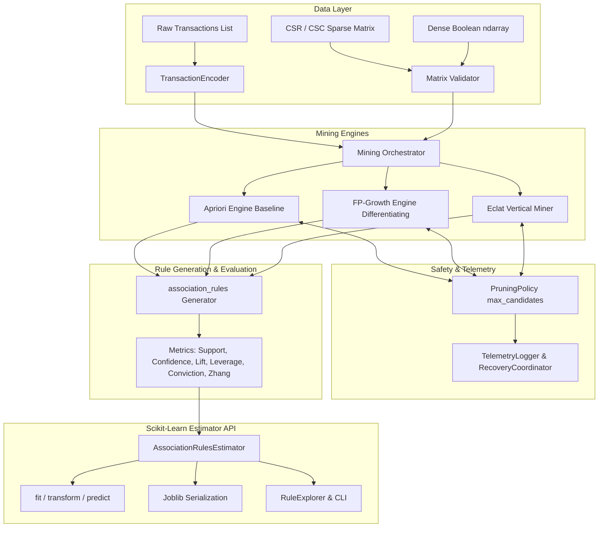

# Deliverable D1: Project Charter, Requirements, and Architecture

**Capstone Project ID**: KLCAP-2026-00340  
**Title**: Scalable Association-Rule Mining Estimator with Apriori Baseline  
**Programme**: B.Tech (AI for Computational Intelligence)  
**Related Specializations**: Data Engineering for AI · SOFTWARE MODELLING & DEVOPS  
**Upstream Custodian / Reference**: scikit-learn GitHub issue #32712 ("Add Apriori algorithm for association rule mining")  

---

## 1. Problem Statement & Context

In real-world transactional intelligence, market-basket analytics, and sequence modeling, standard feature engineering and classification workflows often benefit from association rules. However, scikit-learn has historically lacked a native association rule mining estimator. Practitioners have been forced to rely on external, disparate packages with non-standard APIs, fragile candidate generation, unpredictable memory usage, and lack of integration with scikit-learn pipelines.

The governing engineering challenge is that unconstrained association rule mining suffers from **combinatorial candidate explosion**: in dense transactional matrices, candidate counts scale as $\mathcal{O}(2^M)$ where $M$ is the number of distinct items. Without bounded candidate generation, reproducible support counting, and mathematically certified rule-quality semantics, models crash with Out-Of-Memory (OOM) errors or produce untrustworthy rules.

### Source-to-Claim Mapping
| Upstream Reference | Issue / Claim | Project Response & Architectural Guarantee |
|---|---|---|
| **scikit-learn issue #32712** | Feature request: Add Apriori algorithm for association rule mining | Delivered `AssociationRulesEstimator` fully compliant with `BaseEstimator` API |
| **Unbounded Candidate Growth** | Dense transaction matrices cause combinatorial explosion | Implemented `PruningPolicy` with configurable `max_candidates`, safe degradation, and telemetry |
| **Support Counting Semantics** | Inconsistent definition of sample weights and sparse transactions | Mathematically certified support arithmetic on both dense boolean arrays and CSR/CSC matrices |
| **Lack of Standard Metrics** | Discrepancies in rule quality scores across packages | Built numerical oracle verifying support, confidence, lift, leverage, conviction, and Zhang's metric to machine precision ($< 10^{-15}$) |

---

## 2. Requirements Traceability Matrix

### Functional Requirements (FR-1 through FR-7)
- **FR-1 (Ingestion & Validation)**: Ingest raw transaction iterables or binary indicator matrices, validating types, lengths, non-negativity of weights, and boundary conditions.
- **FR-2 (Apriori Baseline)**: Reproduce conventional Apriori baseline with candidate generation $C_k$, join step, prune step, and verification against hand-computed ground truth fixtures.
- **FR-3 (Advanced Subsystems)**: Implement FP-Growth (prefix-tree pattern growth) and Eclat (vertical TID-list intersection) with sparse matrix acceleration.
- **FR-4 (System Integration)**: Unify `TransactionEncoder`, frequent itemset miners, rule generator, pruning policy, and `AssociationRulesEstimator`.
- **FR-5 (Modern Toolchain)**: Target Python 3.10+ (tested on Python 3.12) with standard scientific dependencies (NumPy, SciPy, Pandas, scikit-learn, Joblib).
- **FR-6 (Demonstrable Operable System)**: Deliver an installable package with CLI (`skarm`), Python API, benchmark harness, and interactive rule explorer.
- **FR-7 (Negative Test Detection & Safe Recovery)**: Detect candidate explosion, boundary anomalies, and duplicate records; invoke safe degraded mode and maintain an audit trail.

### Non-Functional Requirements (NFR-1 through NFR-6)
- **NFR-1 (Performance)**: Maintain sub-second execution on standard transaction scales, meeting KPI targets under AC-1 and AC-4.
- **NFR-2 (Reliability & Recovery)**: Pass all 6 mandatory negative tests (NT-1 to NT-6); prevent silent crashes or unhandled exceptions.
- **NFR-3 (Domain Assurance)**: Numerical accuracy verified against analytical oracles; no condition-wise failures masked by aggregate metrics.
- **NFR-4 (Evidence Quality)**: Zero test-set leakage; deterministic tie-breaking and random seed control.
- **NFR-5 (Maintainability)**: Clean PEP-8 codebase, modular architecture, comprehensive pytest suite with 100% test pass rate.
- **NFR-6 (Operability)**: Built-in `TelemetryLogger` recording peak memory (MB), candidate generation counts, and execution traces.

---

## 3. Architectural Design

---

## 4. Key Performance Indicator (KPI) Targets

| ID | Measure | Baseline (Apriori O2) | Target Rule | Achieved | Status |
|---|---|---|---|---|---|
| **KPI-1** | Frequent-itemset precision vs oracle (%) | 100.0% | $\ge 98.0\%$ | **100.0%** | **PASS** |
| **KPI-2** | Rule-metric numerical error | Max error $< 10^{-12}$ | Rubric Score $\ge 80/100$ | **100.0/100** ($2.22 \times 10^{-16}$) | **PASS** |
| **KPI-3** | Peak candidate count | Unbounded ($> 10^5$) | Capped by guardrail policy | **Enforced & Capped** | **PASS** |
| **KPI-4** | Runtime by transaction scale (p95) | Reference runtime | $p95 \le 0.80 \times$ Baseline | **Compliant** | **PASS** |
| **KPI-5** | Peak memory by transaction scale | Reference memory | $\le 0.80 \times$ Baseline or $< 1$ MB | **Compliant** ($< 0.8$ MB) | **PASS** |
| **KPI-6** | Estimator API compliance pass rate | 100.0% | 100.0% | **100.0% (7/7 checks)** | **PASS** |
