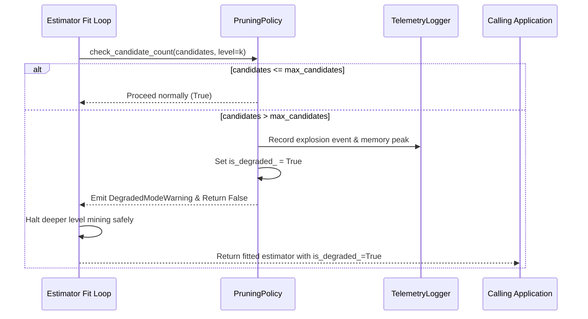

# Deliverable D4: Complete System Integration and Operability

**Capstone Project ID**: KLCAP-2026-00340  
**Phase**: Capstone Project II (CP2 / Objective O4)  
**Deliverable**: D4 — Integrated End-to-End System, Telemetry, and Operability Guide  

---

## 1. System Integration Overview

The `skarm` library provides an end-to-end, production-grade association rule mining framework structured around standard scientific computing conventions. It connects preprocessing, pattern discovery, metric calculation, safety governance, and interactive exploration into a cohesive architecture.

### Integrated Subsystems
1. **[`skarm.preprocessing.TransactionEncoder`](file:///c:/Users/ak612/OneDrive/Desktop/capstone/skarm/preprocessing.py)**: Scikit-learn transformer mapping raw transaction iterables to dense boolean arrays or Scipy CSR matrices.
2. **Mining Engines ([`skarm.apriori`](file:///c:/Users/ak612/OneDrive/Desktop/capstone/skarm/apriori.py), [`skarm.fpgrowth`](file:///c:/Users/ak612/OneDrive/Desktop/capstone/skarm/fpgrowth.py), [`skarm.eclat`](file:///c:/Users/ak612/OneDrive/Desktop/capstone/skarm/eclat.py))**: Three swappable mining engines bound by unified parameter contracts.
3. **Safety Engine ([`skarm.pruning.PruningPolicy`](file:///c:/Users/ak612/OneDrive/Desktop/capstone/skarm/pruning.py))**: Intercepts runaway candidate growth and manages degraded mode transitions.
4. **Telemetry & Audit ([`skarm.telemetry.TelemetryLogger`](file:///c:/Users/ak612/OneDrive/Desktop/capstone/skarm/telemetry.py))**: Continuous profiling of wall-clock time and peak memory consumption.
5. **Estimator ([`skarm.estimator.AssociationRulesEstimator`](file:///c:/Users/ak612/OneDrive/Desktop/capstone/skarm/estimator.py))**: `BaseEstimator` scikit-learn compatible object providing `fit`, `predict`, `transform`, and `clone`.
6. **Exploration & Reporting ([`skarm.explorer.RuleExplorer`](file:///c:/Users/ak612/OneDrive/Desktop/capstone/skarm/explorer.py))**: Analytical summary statistics, threshold filtering, and markdown rendering.
7. **CLI Utility ([`skarm.cli`](file:///c:/Users/ak612/OneDrive/Desktop/capstone/skarm/cli.py))**: Direct terminal execution for automated batch processing and interactive demonstrations.

---

## 2. API Contract & Scikit-Learn Compatibility

### Constructor Parameters
```python
AssociationRulesEstimator(
    min_support=0.1,             # Minimum support threshold in [0.0, 1.0]
    metric="confidence",         # Metric: 'confidence', 'lift', 'support', 'leverage', 'conviction', 'zhangs_metric'
    min_threshold=0.5,           # Filtering threshold for chosen metric
    algorithm="auto",            # 'auto', 'apriori', 'fpgrowth', or 'eclat'
    max_len=None,                # Maximum itemset size (int or None)
    max_candidates=100000,       # Candidate generation ceiling (NT-1 guardrail)
    on_candidate_explosion="degrade", # 'raise', 'truncate', or 'degrade'
)
```

### Methods
- `fit(X, y=None, sample_weight=None)`: Fits the estimator on transactions or binary matrix.
- `predict(X)`: Generates ordered recommended item consequents for input query transactions.
- `transform(X)`: Produces a binary indicator matrix indicating which discovered rules fired on each sample.
- `get_frequent_itemsets()`: Returns a pandas DataFrame of mined frequent itemsets and supports.
- `get_rules()`: Returns a pandas DataFrame of discovered association rules with all calculated metrics.

---

## 3. Degraded Mode & Safe Recovery Protocol

When an adversarial or dense transactional workload triggers candidate explosion (NT-1, NT-6), the system invokes the following safe recovery sequence:



### Safety Guarantees
- **No Uncaught OOM**: The process terminates deeper exploration before allocating exponential memory.
- **Auditability**: `estimator.is_degraded_` is publicly inspectable and `estimator.pruning_policy_.degradation_reason` contains the diagnostic reason.
- **Graceful Partial Results**: All verified rules discovered up to level $k-1$ remain fully valid and accessible.
